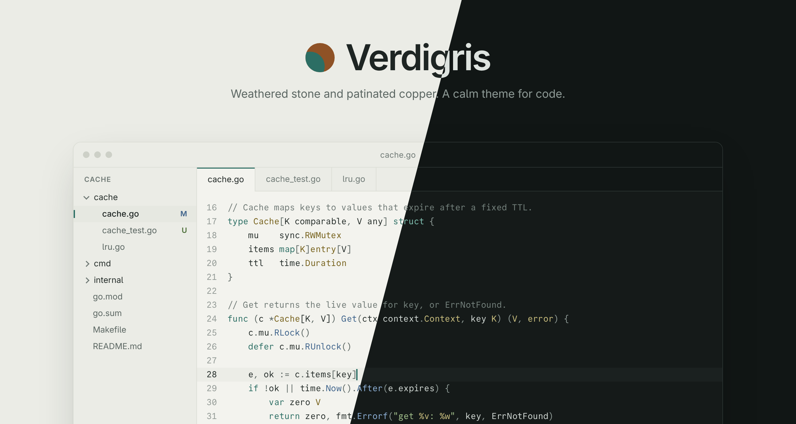
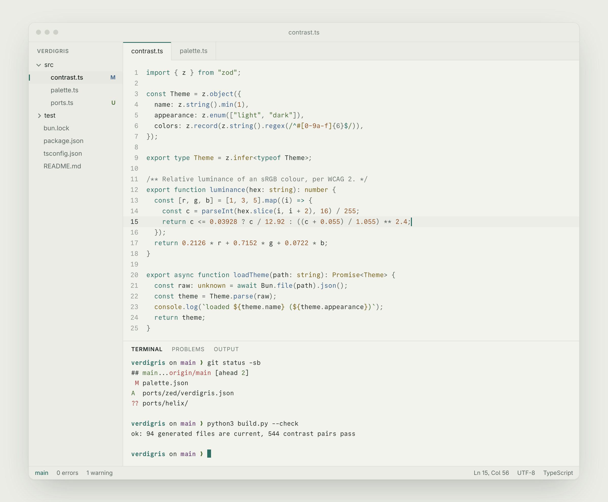
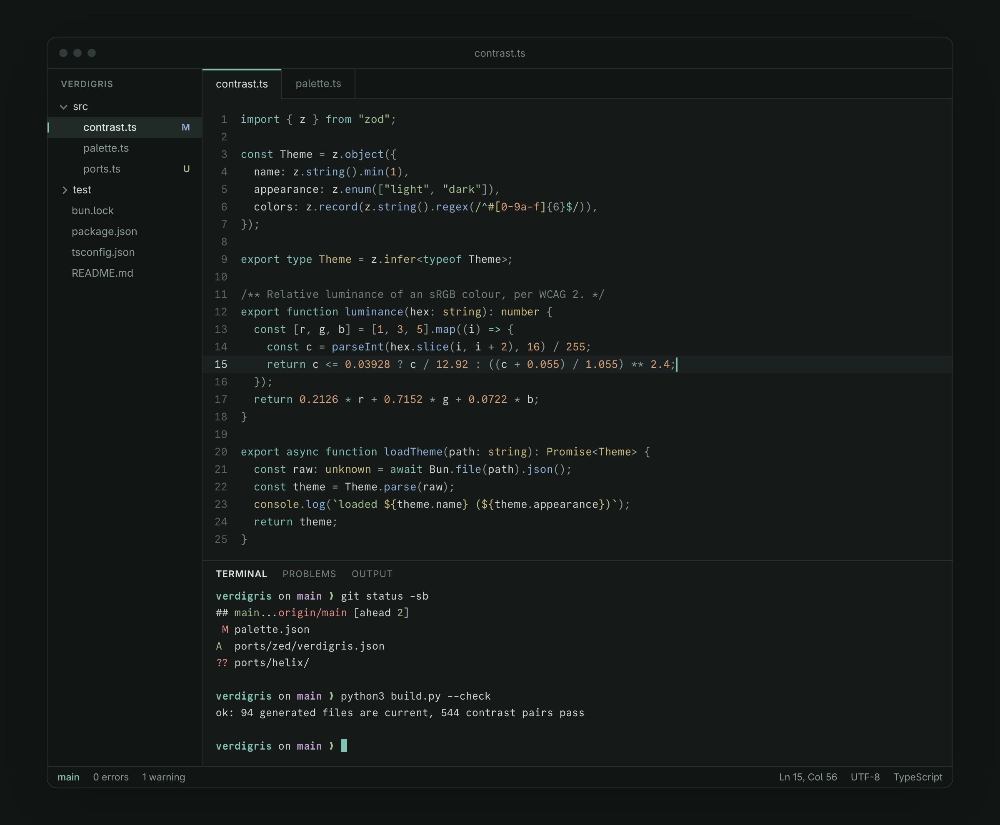
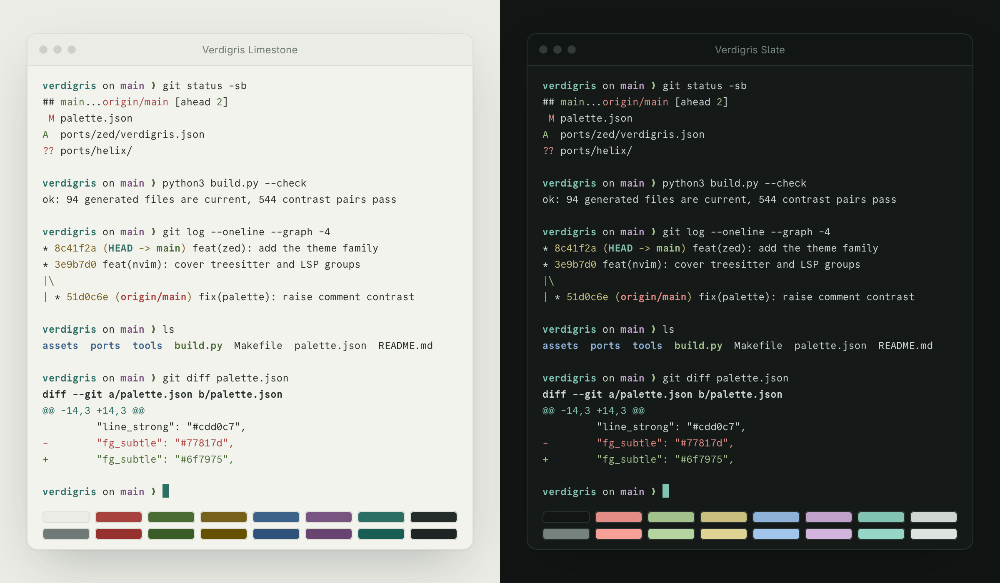
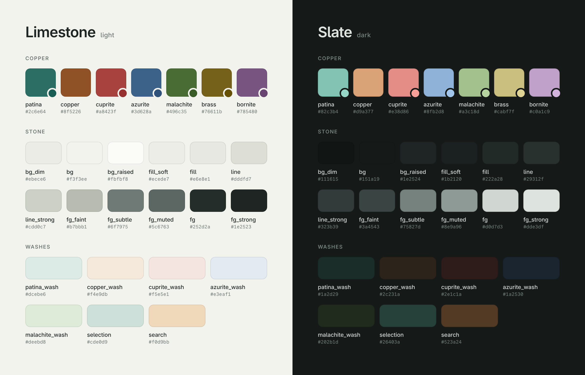

# Verdigris

<p align="center">
  
</p>

Verdigris is a colour theme for code in two flavours. **Limestone** is light and **Slate** is dark. One palette file drives 14 ports for editors, terminals, and command-line tools.

Verdigris is the blue-green layer that forms on copper left out in the weather, and the theme takes its colours from that. The surfaces are grey-green stone, never white and never black. Patina is the single accent. Bare copper is the one warm colour, kept for numbers, warnings, and search matches. The other hues are named after copper's minerals and its alloy: cuprite red, azurite blue, malachite green, bornite purple, and brass. Those seven hues are the whole set, so a screen of code stays quiet.

## Flavours

### Limestone



### Slate



### Terminal

Both flavours define the 16 ANSI colours. The session below is a scripted transcript with the colour codes that git and ls emit, drawn in each flavour's terminal palette.



## Palette



[`palette.json`](palette.json) is the source of every colour. Each flavour defines the same 32 names. The roles for syntax, terminals, and status colours point at those names, so a role has the same meaning in both flavours.

<!-- palette:start -->

### Copper

| Colour | Limestone | Slate | Used for |
| --- | --- | --- | --- |
| `patina` |  `#2c6e64` |  `#82c3b4` | The accent: keywords, cursor, focus, links. ANSI cyan. |
| `copper` |  `#8f5226` |  `#d9a377` | The one warm note: numbers, constants, warnings, search. |
| `cuprite` |  `#a8423f` |  `#e38d86` | Errors and deletions. ANSI red. |
| `azurite` |  `#3d628a` |  `#8fb2d8` | Functions, information, changes. ANSI blue. |
| `malachite` |  `#496c35` |  `#a3c18d` | Strings, additions, success. ANSI green. |
| `brass` |  `#76611b` |  `#cabf7f` | Types, attributes, escapes. ANSI yellow. |
| `bornite` |  `#785480` |  `#c0a1c9` | Decorators, self and this. ANSI magenta. |

### Stone

| Colour | Limestone | Slate | Used for |
| --- | --- | --- | --- |
| `bg_dim` |  `#ebece6` |  `#111615` | Sidebars, status and tab bars, inset code. ANSI black. |
| `bg` |  `#f3f3ee` |  `#151a19` | Editor and terminal background. |
| `bg_raised` |  `#fbfbf8` |  `#1e2524` | Menus, popups and floating windows. |
| `fill_soft` |  `#ecede7` |  `#1b2120` | Cursor line and quiet hover. |
| `fill` |  `#e6e8e1` |  `#222a28` | Hover, inactive selection, chips. |
| `line` |  `#dddfd7` |  `#29312f` | Borders and rules. |
| `line_strong` |  `#cdd0c7` |  `#323b39` | Input borders, indent guides, scrollbars. |
| `fg_faint` |  `#b7bbb1` |  `#3a4543` | Whitespace markers and disabled text. |
| `fg_subtle` |  `#6f7975` |  `#75827d` | Comments, line numbers, ANSI bright black. |
| `fg_muted` |  `#5c6763` |  `#8e9a96` | Secondary text, operators, punctuation. |
| `fg` |  `#252d2a` |  `#d0d7d3` | Code and terminal text. ANSI white. |
| `fg_strong` |  `#1e2523` |  `#dde3df` | Headings and emphasis. ANSI bright white. |

<details>
<summary>Bright variants and washes</summary>

| Colour | Limestone | Slate | Used for |
| --- | --- | --- | --- |
| `patina_bright` |  `#195e55` |  `#95d6c7` | ANSI bright cyan. |
| `cuprite_bright` |  `#963130` |  `#f8a098` | ANSI bright red. |
| `azurite_bright` |  `#2e5279` |  `#a2c5ec` | ANSI bright blue. |
| `malachite_bright` |  `#3a5c26` |  `#b6d4a0` | ANSI bright green. |
| `brass_bright` |  `#665102` |  `#ded392` | ANSI bright yellow. |
| `bornite_bright` |  `#684570` |  `#d3b4dd` | ANSI bright magenta. |

| Colour | Limestone | Slate | Used for |
| --- | --- | --- | --- |
| `patina_wash` |  `#dcebe6` |  `#1a2d29` | Accent surfaces and hints. |
| `copper_wash` |  `#f4e9db` |  `#2c231a` | Warning surfaces. |
| `cuprite_wash` |  `#f5e5e1` |  `#2e1c1a` | Error surfaces and removed lines. |
| `azurite_wash` |  `#e3eaf1` |  `#1a2530` | Information surfaces and changed lines. |
| `malachite_wash` |  `#deebd8` |  `#202b1d` | Added lines. |
| `selection` |  `#cde0d9` |  `#26403a` | Selected text. |
| `search` |  `#f0d9bb` |  `#523a24` | Search matches. |

</details>

<!-- palette:end -->

## Ports

| Port | Directory | What you get |
| --- | --- | --- |
| Alacritty | [`ports/alacritty`](ports/alacritty) | Two colour schemes |
| bat, delta, Sublime Text | [`ports/bat`](ports/bat) | Two `.tmTheme` files and matching delta styles |
| fish | [`ports/fish`](ports/fish) | One theme that follows the terminal's light or dark background |
| fzf | [`ports/fzf`](ports/fzf) | `--color` options for bash, zsh, and fish |
| Ghostty | [`ports/ghostty`](ports/ghostty) | Two themes |
| Helix | [`ports/helix`](ports/helix) | Two themes |
| kitty | [`ports/kitty`](ports/kitty) | Two themes |
| Neovim | [`ports/nvim`](ports/nvim) | One colorscheme for both backgrounds, with treesitter, LSP, and plugin groups, and a lualine theme |
| Pygments | [`ports/pygments`](ports/pygments) | Two styles in an installable package |
| T3 Code | [`ports/t3code`](ports/t3code) | One theme with a light base and a dark variant |
| VS Code | [`ports/vscode`](ports/vscode) | An extension with two colour themes |
| WezTerm | [`ports/wezterm`](ports/wezterm) | Two colour schemes |
| Windows Terminal | [`ports/windows-terminal`](ports/windows-terminal) | Two colour schemes in one fragment |
| Zed | [`ports/zed`](ports/zed) | One theme family |

Each directory has a README with the install steps.

## Quick start

```sh
git clone https://github.com/mr-karan/verdigris
cd verdigris
```

Then follow the README of the port you want. For Ghostty, the steps are:

```sh
mkdir -p ~/.config/ghostty/themes
cp ports/ghostty/verdigris-* ~/.config/ghostty/themes/
echo "theme = light:verdigris-limestone,dark:verdigris-slate" >> ~/.config/ghostty/config
```

Where a tool can follow the system appearance, its README shows how to pair Limestone with Slate.

## Contrast

Ratios follow WCAG 2. The build fails when a colour falls below its minimum:

- **4.5 to 1** for text, for every hue, and for every syntax and ANSI colour. The build checks them on the editor background, the sidebar, popups, the cursor line, and hover fills.
- **3.5 to 1** for the quiet colour used by comments, line numbers, and ANSI bright black.
- **3 to 1** for a hue on selected text, and for the cursor.

<!-- contrast:start -->

| On the editor background | Minimum | Limestone | Slate |
| --- | --- | --- | --- |
| Text | 4.5 | 12.68 | 12.02 |
| Emphasis | 4.5 | 14.04 | 13.51 |
| Muted text | 4.5 | 5.28 | 6.04 |
| Comments | 3.5 | 4.04 | 4.39 |
| `patina` | 4.5 | 5.36 | 8.72 |
| `copper` | 4.5 | 5.54 | 7.92 |
| `cuprite` | 4.5 | 5.37 | 7.05 |
| `azurite` | 4.5 | 5.70 | 7.98 |
| `malachite` | 4.5 | 5.42 | 8.85 |
| `brass` | 4.5 | 5.40 | 9.44 |
| `bornite` | 4.5 | 5.58 | 7.69 |

The build checks 544 pairs. The lowest ratio among the 514 body-text pairs is 4.75 in Limestone and 5.04 in Slate.

<!-- contrast:end -->

One choice is unusual. In Limestone the hues are dark enough to read as text, so dark text on a hue would be unreadable. For that reason ANSI black is a background shade and ANSI white is the text colour in both flavours. A status bar that prints black on green stays readable in Limestone and in Slate, and so does white text on the default background.

## Build

The build needs Python 3.11 or later and nothing else.

```sh
python3 build.py     # check contrast, then regenerate every port and the tables above
make check           # fail on a contrast regression, a stale generated file, or a failing test
make validate        # load each port in the tool it is for, where that tool is installed
make screenshots     # render the images in assets/, with bat and chromium
```

`make validate` reports a missing tool as a skip. The images come from the ports themselves: bat highlights the code with the generated `.tmTheme`.

## Contributing

To change a colour, edit `palette.json`, run `python3 build.py`, and commit the palette together with the regenerated files. Do not edit a generated file by hand. `make check` fails when a file differs from what the palette produces.

To add a port, create `ports/<name>/build.py` with a `render(palette)` function that returns `{file name: text}`, and a `README.md` with the install steps. `build.py` finds the new directory without registration. Then add a check to `tools/validate.py` that loads the output in the real tool.

## License

[MIT](LICENSE), copyright Karan Sharma.
